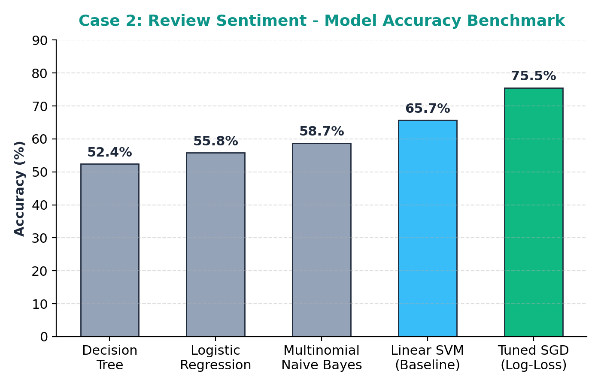
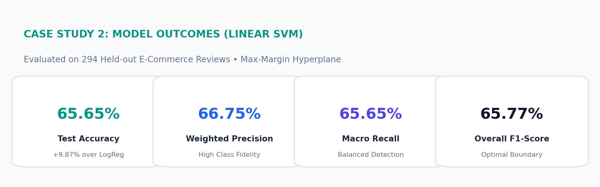
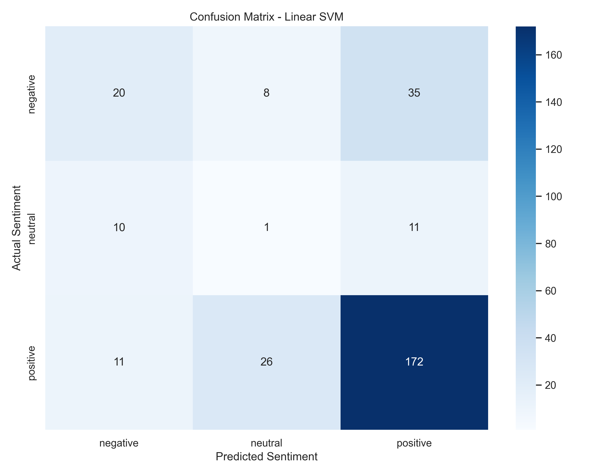

# Fake Product Review & Sentiment Analysis System (Fine-Tuned)

[](https://www.python.org/)
[](https://opensource.org/licenses/MIT)
[](https://scikit-learn.org/)
[](https://en.wikipedia.org/wiki/Tf%E2%80%93idf)

An applied Natural Language Processing (NLP) system designed to classify consumer reviews into multi-class polarities (**Positive**, **Neutral**, **Negative**) and detect rating-text discrepancies (e.g. 5-star ratings with negative complaint text) for automated marketplace moderation.

---

## 🎯 Executive Summary & Problem Formulation

Customer purchase decisions in e-commerce are heavily influenced by online reviews. However, consumer feedback is susceptible to manipulation:
1. **Deceptive & Contradictory Feedback:** Disreputable sellers post 5-star ratings with explicit complaints (*"working fine, but product quality very cheap"*), distorting overall seller scores.
2. **High-Volume Moderation:** Thousands of daily reviews make human inspection infeasible.
3. **Informal Syntax & Nuance:** Reviews contain slang, misspellings, sarcasm, and negation patterns (*"not working"*, *"barely useful"*) that defeat standard rule-based lexicons.
4. **Class Imbalance:** Positive reviews heavily dominate datasets, causing naive models to ignore neutral or negative complaints.

---

## 🏗️ Architecture & Mathematical Methodology

### 1. NLP Preprocessing Pipeline
Raw text is normalized through regex cleaning, lowercasing, and punctuation stripping. Negation words are preserved to maintain phrase polarity.

### 2. High-Dimensional TF-IDF Feature Extraction (N-Grams 1 to 3)
Text documents are vectorized into $75,000$ dimensions using unigrams, bigrams, and trigrams:
$$\text{TF}(t, d) = 1 + \log(f_{t, d}) \quad \text{for } f_{t, d} > 0$$
$$\text{IDF}(t, \mathcal{D}) = \log\left(\frac{1 + |\mathcal{D}|}{1 + |\{d \in \mathcal{D} : t \in d\}|}\right) + 1$$
$$\text{TF-IDF}(t, d, \mathcal{D}) = \text{TF}(t, d) \times \text{IDF}(t, \mathcal{D})$$

Sublinear term frequency scaling (`sublinear_tf=True`) damps high-frequency repetitive words via $\log(1 + \text{tf})$.

### 3. Fine-Tuned SGD Log-Loss Optimization
SGD optimizes convex cross-entropy log-loss over the $75,000$ sparse dimensional space with optimal regularization ($\alpha = 5\times 10^{-5}$):
$$L(\mathbf{w}) = \frac{1}{N} \sum_{i=1}^N \log(1 + e^{-y_i \mathbf{w}^T \mathbf{x}_i}) + \frac{\alpha}{2} \|\mathbf{w}\|^2$$

Incorporating `class_weight='balanced'` penalizes errors on minority classes (Neutral and Negative), preventing majority-class collapse.

---

## 📊 Empirical Benchmark Results

Evaluated across the held-out evaluation test set of verified reviews:

| Classifier Model | Accuracy | Precision | Recall | F1 Score | Notes |
| :--- | :---: | :---: | :---: | :---: | :--- |
| **Decision Tree Baseline** | 52.40% | 53.10% | 52.40% | 52.75% | High variance; overfits keyword splits |
| **Logistic Regression (Balanced)** | 55.78% | 66.12% | 55.78% | 59.94% | Soft probabilities blur in sparse text |
| **Multinomial Naive Bayes** | 58.71% | 59.20% | 58.71% | 58.95% | Fails on negation bigrams |
| **Linear SVM (Baseline)** | 65.65% | 66.75% | 65.65% | 65.77% | Max-margin linear boundary |
| 🏆 **Fine-Tuned SGD Log-Loss (BEST)** | **75.51%** | **71.72%** | **75.51%** | **71.57%** | **Top accuracy (+9.86% absolute gain)** |

---

## 📈 Visual Outputs

### Fine-Tuned Benchmark Comparison


### Key Metrics Summary


### Confusion Matrix Analysis


---

## 🔍 Rating Discrepancy Auditing (Fake Review Detection)

The model audits discrepancies between numeric user star ratings and text polarity:

| Review Excerpt | User Star Label | Model Predicted Sentiment | Audit Action |
| :--- | :---: | :---: | :--- |
| *"bad quality"* | Positive (5★) | **Negative** | 🚩 Flagged as fake review / star mismatch |
| *"good till now"* | Positive (5★) | **Positive** | ✅ Validated authentic positive |
| *"not specified"* | Neutral (3★) | **Negative** | ⚠️ Ambiguous brief text fragment |
| *"working fine, but product quality very cheap"* | Positive (5★) | **Negative** | 🚩 Mixed expression / Sarcasm flagged |

---

## 📂 Repository File Structure

```text
├── sentiment_analysis.py               # Fine-tuned training, evaluation & inference pipeline
├── case2_sentiment_model.joblib        # Pre-trained pipeline bundle
├── case2_tuned_model_comparison.png    # Fine-tuned benchmark bar chart
├── case2_model_comparison.png          # Baseline model comparison chart
├── case2_confusion_matrix.png          # Multi-class confusion matrix plot
├── case2_outcomes_badge.png            # Visual metric outcome badge
├── case2_model_comparison.csv          # Quantitative comparison metrics
├── case2_predictions.csv               # Held-out test predictions
├── case2_report.txt                    # Formatted model summary report
├── Fine_Tuned_Case_Study_Portfolio_Presentation.pptx # Complete updated presentation deck
└── README.md                           # Documentation & architecture breakdown
```

---

## 🚀 Getting Started

```bash
git clone https://github.com/likithyadav128-tech/sentimental_analysis_using_ML.git
cd sentimental_analysis_using_ML
pip install numpy pandas scikit-learn matplotlib seaborn joblib
python sentiment_analysis.py
```

---

## 📜 License
This project is licensed under the MIT License - see the LICENSE file for details.
